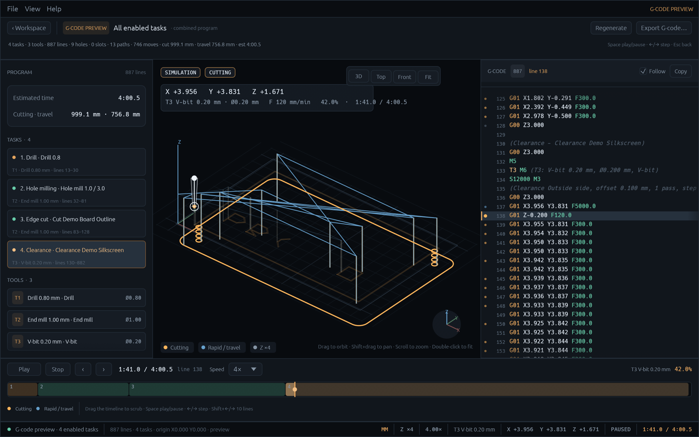

# PCB-CAM

**Cross-platform CAM workbench for PCB fabrication.**

PCB-CAM turns Gerber and Excellon fabrication data into CNC control programs.
It is a native desktop application written in Rust with
[egui](https://github.com/emilk/egui)/[eframe](https://github.com/emilk/egui/tree/main/crates/eframe),
inspired by [FlatCAM](https://flatcam.org/).



## Project status

**Milestone 5: G-code preview and machine simulation — complete.** Version 0.1.0.

The application works end to end: import fabrication data, build a tool library,
plan tasks, preview the generated program and export G-code. It is still
early-stage software, so review every program before running it on a machine.

## Features

- **Gerber RS-274X import** via
  [`gerber_parser`](https://crates.io/crates/gerber_parser): lines, arcs,
  regions, flashes, circle/rectangle/obround/polygon apertures, parameterised
  aperture macros, dark/clear polarity and conversion to millimetres.
- **Excellon import**: metric and inch headers, fixed-format and decimal
  coordinates, drill hits, `G85` slots and `M15`/`M16` routed slots.
- **Canvas**: fit, pan, zoom, grid, axes, scale bar, layer visibility and
  correct triangulation of concave Gerber regions.
- **Layer mirroring** for bottom-side artwork: flip one layer or all layers
  horizontally, vertically or both. Flip axes are created on the first flip and
  can be dragged on the canvas or set exactly from the Layer menu.
- **Tool model**: read-only source tools from the fabrication data and a
  persistent library of machining tools. Excellon source tools filter which
  holes and slots a task machines.
- **Machining tasks**: drilling, hole milling with helical interpolation and
  slot routing, spot drilling, edge cutting with depth passes and bridges, and
  clearance routing around unioned copper.
- **G-code preview**: 3D toolpath playback with a syntax-highlighted program,
  command following, task markers, a scrub timeline, cycle-time estimates and
  single-task or combined export.
- **Workflow**: inline task inspector, task reordering and enable/disable,
  undo/redo, a G-code 0-point, `.pcbcam` projects, recent files and
  unsaved-changes prompts.
- **Settings**: system/dark/light theme, canvas colours and machining defaults
  for travel, drilling, milling and clearance.
- **Import conveniences**: native file dialogs, drag and drop, Gerber/Excellon
  ZIP archives and a bundled demo project.
- **Foundation**: GUI-independent core crate, command-driven engine crate,
  cross-platform CI and a macOS application-bundle script.

## Source tools and machining tools

PCB-CAM keeps two deliberately separate tool concepts:

- **Source tools** are the read-only tools embedded in the imported data.
  Excellon tool numbers select which holes and slots a task machines. The
  browser currently lists Excellon drill tools; Gerber aperture metadata is
  parsed but not yet exposed in the UI.
- **Machining tools** are cutters from the user's library: drills, end mills,
  V-bits and cone/spot drills, with diameter, feed, plunge and spindle
  defaults. Every task references exactly one machining tool. The library is
  shared between projects and persisted in the application settings; a tool
  that is still used by a task cannot be removed.

This separation is intentional: a source tool says **which objects** belong to
a task, while a machining tool says **how** they are cut. Tool changes
(`T… M6`) in G-code come from the machining tools, not from source drill
diameters.

## Tasks

| Task | Source | Machining tool | Notes |
| --- | --- | --- | --- |
| Drilling | Excellon holes | drill bit | vertical plunge only |
| Hole milling | Excellon holes and slots | end mill or V-bit | helical interpolation for holes larger than the tool; routed slots |
| Spot drilling | Excellon hole centres | cone/spot drill | ignores hole diameters and slots |
| Edge cut | Gerber closed contours | end mill or V-bit | outside/inside/on-line offset, depth passes, optional bridges |
| Clearance | Gerber paths (copper, silkscreen, etc.) | V-bit or end mill | isolation routing with a clearing width |

- **Depth passes** — `Stepdown` is the maximum depth increase per pass; the
  pass count is `ceil(depth / stepdown)` and the last pass is clamped to the
  total depth.
- **Bridges** — tabs keep the part in the stock. `Count` is the number of
  bridges per closed contour (`0` disables them), `Length` defaults to `2 mm`
  and `Start depth` to `0.5 mm`. While crossing a bridge the cutter is raised to
  the start depth, leaving the material below it intact.
- **Clearance width** — the width of the copper-free band, default `2 mm`.
  The pass count is `ceil(width / offset step)`; a width of `0` keeps one pass.
  New edge-cut and clearance tasks derive their offsets from the selected tool
  radius/diameter, and both values remain editable.

Drilling tasks can be created even when the library has no exact drill: the
closest cutter is selected and the inspector explains the mismatch. G-code
export is blocked while a task has unresolved warnings.

## Requirements

- Rust stable **1.95+** (edition 2024; see `rust-toolchain.toml`)
- A GPU and driver supported by `wgpu`
- On Linux:

```bash
sudo apt-get install -y \
  libxkbcommon-dev libxkbcommon-x11-dev libwayland-dev \
  libx11-dev libx11-xcb-dev libxcb1-dev libxcb-render0-dev \
  libxcb-shape0-dev libxcb-xfixes0-dev libxrandr-dev libxi-dev \
  libxcursor-dev libegl1-mesa-dev libgl1-mesa-dev libvulkan-dev
```

## Build and run

```bash
# Development build and run
cargo run -p pcb-cam

# Bundled demo board: 4 layers, 4 tasks
cargo run -p pcb-cam -- --sample

# Open fabrication files directly
cargo run -p pcb-cam -- path/to/board-F_Cu.gbr path/to/board.drl

# Import every Gerber/Excellon entry from a ZIP
cargo run -p pcb-cam -- path/to/gerber-drill.zip

# Optimized binary
cargo build --release --locked -p pcb-cam
./target/release/pcb-cam
```

The binary is `target/release/pcb-cam` (`pcb-cam.exe` on Windows).

### macOS application bundle

```bash
./scripts/package-macos.sh
open dist/PCB-CAM.app
```

The script builds a release binary, assembles `PCB-CAM.app` with the icon,
`Info.plist`, `LICENSE` and third-party notices, ad-hoc signs it and creates
`dist/PCB-CAM-macos.zip`.

## Quick start

1. **Import** with **File → Import…** (`Cmd/Ctrl+Shift+O`), the **Import**
   button, or by dropping files on the window. Gerber, Excellon and ZIP
   archives are detected automatically. **File → Load Demo Project** opens the
   bundled sample instead.
2. **Add a tool** under **Machining tools → + Machining tool**, or press `+` on
   an Excellon source tool to create a matching drill.
3. **Add a task** from **+ Task**, the **Tasks** menu, the timeline or the
   selected layer's inspector.
4. **Edit the selected task** in the inspector: choose one machining tool,
   select source tools for drilling, hole milling and spot drilling, and adjust
   depths, feeds and task-specific parameters. Changes apply immediately.
5. **Set the G-code 0-point** with **0-point** in the toolbar: enter absolute
   X/Y values, drag the `G0` marker, or use **Pick on canvas**. Double-click the
   marker to reopen the value dialog.
6. **Preview and export**:
   - **File → Preview Selected Task G-code…** (or the inspector button) for one
     task.
   - **File → Preview All Tasks G-code…** (or the timeline button) for the
     combined program with automatic tool changes.
   - Use **Export G-code…** in the preview header or `Cmd/Ctrl+E`. The preview
     stays open after export.
7. **Save** with **File → Save Project** or **Save Project As…**. A `.pcbcam`
   file stores layers, tasks, the G-code origin and a snapshot of the referenced
   machining tools.

## Keyboard shortcuts

| Shortcut | Action |
| --- | --- |
| `Cmd/Ctrl+,` | Settings |
| `Cmd/Ctrl+N` / `Cmd/Ctrl+O` | New / open project |
| `Cmd/Ctrl+S` / `Cmd/Ctrl+Shift+S` | Save / save as |
| `Cmd/Ctrl+Shift+O` | Import Gerber/Excellon/ZIP |
| `Cmd/Ctrl+E` | Preview selected task G-code |
| `Cmd/Ctrl+Shift+E` | Preview all tasks G-code |
| `Cmd/Ctrl+Z` / `Cmd/Ctrl+Shift+Z` | Undo / redo (`Ctrl+Y` also redoes) |
| `Cmd/Ctrl+Q` | Quit |
| `Shift+H` / `Shift+V` | Flip selected layer horizontally / vertically |
| `Delete` or `Backspace` | Remove selected layer, tool or task |
| `F` or double-click | Fit project into the canvas |
| `G` | Toggle grid |
| `F1` | About |
| `Esc` | Close dialog or return from the G-code preview |

### G-code preview

| Shortcut | Action |
| --- | --- |
| `Space` | Play or pause playback |
| `←` / `→` | Step one command; hold `Shift` to step ten |
| `Home` / `End` | Jump to the start or end of the program |
| `+` / `-` | Increase or decrease playback speed |
| `F` | Fit the toolpath into the 3D view |
| `Cmd/Ctrl+E` | Export the previewed program |
| `Cmd/Ctrl+R` | Regenerate the preview |
| `Esc` | Return to the workspace |

Scroll to zoom around the pointer, drag to orbit the 3D view and `Shift`+drag
to pan. Double-click the 3D view to fit the toolpath.

## Project layout

```text
.
├── crates/
│   ├── pcb-cam/                 # egui desktop application
│   │   └── src/
│   │       ├── app.rs           # state, commands, dialogs
│   │       ├── licenses.rs      # embedded third-party notices
│   │       ├── main.rs          # entry point and CLI arguments
│   │       ├── preview.rs       # playback clock and 3D camera
│   │       ├── theme.rs         # palette and egui style
│   │       ├── view.rs          # canvas camera and units
│   │       └── ui/              # menu, panels, viewport, preview, timeline, licenses
│   ├── pcb-cam-engine/          # session, command registry, undo/redo
│   └── pcb-cam-core/            # domain, import, toolpaths, G-code
│       └── src/
│           ├── formats/         # Gerber and Excellon importers
│           ├── geometry.rs      # points, paths, apertures, offsets
│           ├── gcode.rs         # G-code post-processor
│           ├── preview.rs       # timed G-code parser
│           ├── layer.rs         # source layers and tool metadata
│           ├── operation.rs     # tasks and parameters
│           ├── persist.rs       # versioned .pcbcam files
│           ├── project.rs       # project model
│           ├── tool.rs          # machining tools and library
│           └── units.rs         # millimetres and inches
├── about.toml / about.hbs       # cargo-about configuration
├── THIRD_PARTY_LICENSES.md      # generated third-party and font notices
├── assets/                      # icon and synthetic demo files
├── docs/                        # screenshot
├── scripts/                     # license generation, icons and macOS packaging
├── third-party/
│   └── fonts.md                 # handwritten font notices
└── .github/workflows/           # CI
```

## Architecture

```text
pcb-cam-core  ←  pcb-cam-engine  ←  pcb-cam
(domain/import)   (session/commands)   (egui front end)
```

- **core** owns the project model, source geometry, tool metadata, contour
  offsets, G-code generation and the timed preview parser. It has no GUI
  dependencies.
- **engine** owns a `Session`, executes JSON commands such as
  `file.import_gerber`, `task.add_cutout`, `tool.create`,
  `file.export_task_gcode` and `edit.undo`, and keeps project undo/redo
  snapshots. The machining library belongs to the session and is intentionally
  not project-undoable.
- **pcb-cam** is a thin egui front end. It calls commands instead of mutating
  the project directly, so future CLI and automation clients can reuse the same
  registry.

## Development

```bash
cargo fmt --all --check
cargo clippy --workspace --all-targets --locked -- -D warnings
cargo test --workspace --locked
```

The application icon is checked in as SVG, PNG, ICNS and ICO. Regenerate the
raster assets from the vector source with:

```bash
python3 -m pip install pillow
python3 scripts/gen_icons.py
```

The editable source is [`assets/icon.svg`](assets/icon.svg) (1254×1254). The
generator rasterises it with headless Chrome into a 1024×1024 `assets/icon.png`,
writes the `.ico`, and on macOS also rebuilds the `.icns` via `iconutil`. Edit
the SVG, then rerun the generator.

Third-party notices are generated from `Cargo.lock`. After changing
dependencies, regenerate and commit the result:

```bash
cargo install --locked cargo-about --version 0.9.3 --features cli
./scripts/gen-licenses.sh
./scripts/gen-licenses.sh --check   # CI runs this
```

## Roadmap

- Use Gerber source apertures to filter cut-out and clearance objects.
- Machine/post-processor profiles, tool wear data and a machine envelope check.
- Acceleration-aware cycle-time estimates and preview overlays for source
  Gerber/Excellon geometry.

## Known limitations

- Import geometry is flattened to millimetres at load time; the source path is
  kept on the layer.
- Gerber step-and-repeat, aperture blocks and negative image polarity are not
  fully supported; the importer reports warnings instead of failing.
- Gerber aperture metadata is parsed but not yet shown in the UI or used as a
  task filter. Edge-cut and clearance tasks currently process the whole layer.
- Gerber regions with nested contours or islands may not triangulate fully.
- Contour offsets use mitred joins without a full self-intersection cleanup.
- Clearance unions all copper first, then offsets it by the explicit copper
  offset for each pass. The work region is bounded by the selected boundary
  layer's largest closed contour (or that layer's bounds when it has no closed
  contour), or by the visible-layer bounds when no boundary layer is selected.
  The tool diameter is not used by the path builder; the explicit offsets
  control the geometry.
- Slots narrower than the machining tool are rejected; wider slots are routed on
  the centreline, which may not clear the full slot width. Bridges are added to
  every closed contour, including internal cut-outs, and are shortened when a
  sector is too short to hold them.
- Project files are JSON (`.pcbcam`, version 1). Loading merges missing
  machining tools into the shared library; conflicting definitions are cloned
  under a new id and task references are remapped. Recent files live in the
  application settings.
- G-code is emitted in millimetres with explicit drill/plunge moves, relative to
  the selected 0-point. Machine-specific headers, cutter compensation and
  controller-defined `G00` rapids are not supported yet; XY travel uses `G01`
  with the configured travel feed.
- The preview replays the generated subset (`G00`/`G01`/`G02`/`G03`, `G04`,
  `M3`/`M5`/`M6` and `F`/`S`/`T` words) from a safe-Z start. Tool changes and
  spindle starts use fixed simulated durations; acceleration, look-ahead and
  controller-specific timing are not modelled.

## License

PCB-CAM is released under the [MIT License](LICENSE).

Third-party dependencies and bundled fonts are listed in
[THIRD_PARTY_LICENSES.md](THIRD_PARTY_LICENSES.md). Binary releases ship that
file together with `LICENSE`; the macOS app bundle keeps both in
`Contents/Resources`. The same text is available in the application under
**Help → Third-party licenses** (also linked from the About dialog).

Copyright © 2026 andryblack

Gerber import uses the `gerber_parser` crate by the MakerPnP project, licensed
under MIT OR Apache-2.0.
