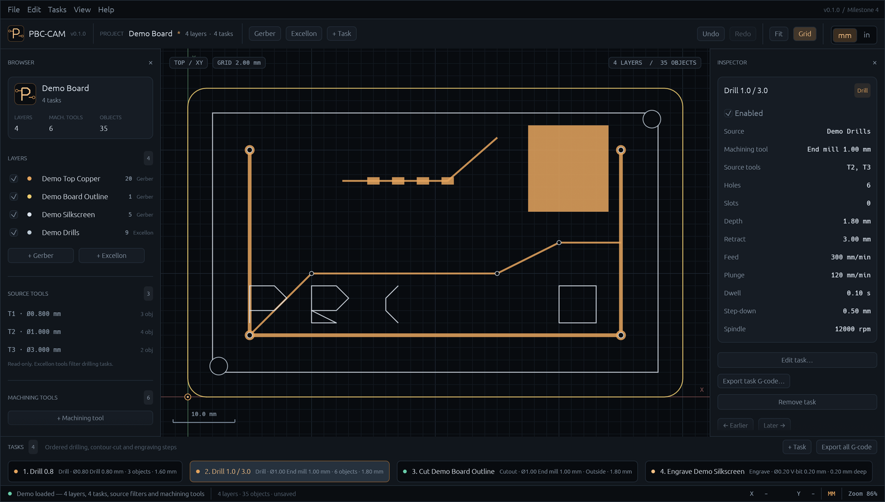

# PBC-CAM

**Cross-platform CAM workbench for PCB fabrication.**

PBC-CAM turns Gerber and Excellon fabrication data into CNC control programs. It is a native desktop application written in Rust with [egui](https://github.com/emilk/egui)/[eframe](https://github.com/emilk/egui/tree/main/crates/eframe), inspired by [FlatCAM](http://flatcam.org/).



## Project status

**Milestone 4: source tools, machining tools and filtered tasks — complete.**

The project keeps two deliberately separate tool concepts:

- **Source tools** are read-only apertures and drill tools found in Gerber and
  Excellon files. They describe the fabrication data. Excellon source tools are
  used to filter which holes/slots a task machines.
- **Machining tools** live in the user's own library: drills, end mills and
  V-bits with diameter, feed, plunge and spindle defaults. Every task references
  exactly one machining tool. The library is shared between projects and
  persisted in the application settings.

G-code can be generated for one task or for all enabled tasks in timeline order.
Tool changes (`T… M6`) are driven by the task machining tools, not by source
drill diameters.

Implemented:

- Native application window on macOS, Windows and Linux (eframe + wgpu)
- Dark CAD workspace with browser, canvas, inspector and task timeline
- Gerber RS-274X import using [`gerber_parser`](https://crates.io/crates/gerber_parser) for the tokenizer, command AST and aperture macros:
  - lines, arcs, regions and flashes
  - circle/rectangle/obround/polygon apertures
  - parameterised aperture macros (for example KiCad `RoundRect`)
  - dark/clear polarity
  - units and coordinate-format conversion to millimetres
- Excellon import:
  - metric and inch headers
  - fixed-format and decimal coordinates
  - tool definitions, drill hits, `G85` slots and `M15`/`M16` routed slots
- Canvas layer rendering with fit-to-project, pan/zoom, grid, axes and scale bar
- Correct triangulation of concave Gerber regions (earcutr) instead of convex fan fill
- Circular-aperture traces with round joins and caps, matching Gerber stroke geometry
- Layer browser with visibility and selection
- **Source tool browser**:
  - Excellon tools with number, diameter and object count
  - Gerber aperture summaries with object counts
  - read-only; Excellon tools filter drilling tasks
- **User machining tool library**:
  - add, edit and remove drills, end mills and V-bits
  - diameter, feed, plunge and spindle defaults
  - persisted across restarts and shared by all projects
  - used by every task; a tool in use cannot be removed
- **Tasks** with type-specific settings:
  - **Drilling** — source-hole filter, machining tool, depth, retract, feed, plunge, dwell, helical step-down, spindle
  - **Contour cut** — machining tool, outside/inside/on-line offset, depth, retract, feed, plunge, spindle
  - **Engraving** — machining tool, depth, retract, feed, plunge, spindle
- Task timeline with selection, enable/disable, creation, reordering and online editing in the inspector
- Selected-task canvas overlay in red: drill/slot positions, contour-cut offset toolpath or engraving paths
- **Helical interpolation** for holes larger than the selected end mill/V-bit. A 1.0 mm end mill can machine a 1.5 mm hole with a helical path; a drill bit is rejected because it cannot side-cut.
- G-code export:
  - selected task only
  - all enabled tasks in timeline order
  - automatic `T… M6` changes between different machining tools
- Undo/redo for imports, layers and tasks
- Native file dialogs, drag-and-drop import, Gerber/Excellon ZIP archives and a bundled demo project
- GUI-independent core crate and a command-driven engine crate
- Cross-platform CI builds and a macOS application bundle script

### Example: one drill task per hole group

Suppose an Excellon file contains holes of 0.3, 1.0 and 1.5 mm, and the user
library contains a 0.3 mm drill and a 1.0 mm end mill:

1. Create a drilling task, select **Drill 0.30 mm** and check only source tool
   `T1` (the 0.3 mm holes).
2. Create a second drilling task on the same layer, select **End mill 1.00 mm**
   and check the source tools for the 1.0 and 1.5 mm holes.
3. Export all tasks. The combined program changes from the 0.3 mm drill to the
   1.0 mm end mill once, plunge-drills the 1.0 mm holes and helically machines
   the 1.5 mm holes.

This separation is the point: the source tool says **which objects belong to a
task**, while the machining tool says **what cutter performs the work**.

Next:

- Use Gerber source tools (apertures) to filter cut-out and engraving objects
- Engraving area fill / hatch patterns in addition to contour engraving
- Contour cut tabs and multi-pass depth stepping
- Isolation routing around copper
- Project save/load (`.pbcam` or JSON)
- G-code preview and machine simulation
- Machine/post-processor profiles and tool wear data

### Known limitations

- Import geometry is flattened to millimetres at load time; the source path is kept on the layer.
- Gerber step-and-repeat, aperture blocks and negative image polarity are not fully supported yet; import reports warnings instead of failing.
- Gerber source apertures are listed, but currently only **drilling tasks** use source tools as filters. Contour-cut and engraving tasks process the whole layer.
- Gerber regions are triangulated; regions with multiple nested contours/islands may not be fully supported yet.
- Contour offsets use mitred joins without a full self-intersection cleanup.
- Engraving follows outlines and paths; filled/hardened area clearing is not implemented.
- Slots narrower than the machining tool are rejected; wider slots are routed on the centreline, which may not clear the full slot width.
- Projects are not saved yet; the machining tool library is persisted, generated G-code is the durable output.
- G-code is emitted in millimetres with explicit drill/plunge moves. It does not yet include machine-specific headers, work offsets or cutter compensation.

## Requirements

- Rust stable **1.95+** (see `rust-toolchain.toml`)
- A GPU and graphics driver supported by `wgpu`
- Linux system libraries:

```bash
sudo apt-get install -y \
  libxkbcommon-dev libxkbcommon-x11-dev libwayland-dev \
  libx11-dev libx11-xcb-dev libxcb1-dev libxcb-render0-dev \
  libxcb-shape0-dev libxcb-xfixes0-dev libxrandr-dev libxi-dev \
  libxcursor-dev libegl1-mesa-dev libgl1-mesa-dev libvulkan-dev
```

## Build and run

```bash
# Development build and run
cargo run -p pbc-cam

# Start with the bundled demo board (4 layers, 4 tasks)
cargo run -p pbc-cam -- --sample

# Open fabrication files directly
cargo run -p pbc-cam -- path/to/board-F_Cu.gbr path/to/board.drl

# Or unpack/import every Gerber + drill file in a ZIP
cargo run -p pbc-cam -- path/to/gerber-drill.zip

# Optimized binary
cargo build --release --locked -p pbc-cam
./target/release/pbc-cam
```

The binary is `target/release/pbc-cam` (`pbc-cam.exe` on Windows).

### macOS application bundle

```bash
./scripts/package-macos.sh
open dist/PBC-CAM.app
```

The script builds a release binary, assembles `PBC-CAM.app` with the app icon and `Info.plist`, ad-hoc signs it and creates `dist/PBC-CAM-macos.zip`.

## Working with tools and tasks

1. Import Gerber layers with **File → Import Gerber…** or the **Gerber** toolbar button.
2. Import an Excellon file with **File → Import Excellon…** or the **Excellon** button.
3. Or import a whole fabrication archive with **File → Import Gerber ZIP…**, the **ZIP** toolbar button, or by dropping a `.zip` on the window. Gerber and Excellon entries are imported automatically; README/order-instruction files are skipped.
4. Select a layer to inspect its **Source tools** in the browser and inspector.
   These are read-only and come from the fabrication file.
5. Open **Machining tools → + Machining tool** to add your own cutter, or select
   a library tool and use **Edit tool…** in the inspector. The library is saved
   automatically in the application settings.
6. Add a task from **+ Task** in the toolbar/timeline or from the browser when a
   suitable layer is selected:
   - **Drilling** needs an Excellon layer.
   - **Contour cut** needs a Gerber layer with closed contours.
   - **Engraving** needs a Gerber layer with paths.
7. Select the task. Edit it directly in the inspector: choose one
   **machining tool**, check the **source tools** for drilling, and change
   depths/feeds. Changes are applied online; there is no separate task-edit dialog.
   While selected, the task is drawn in red on the canvas — drilling positions
   for drill tasks, or the offset/engraving trajectory for milling tasks.
8. Export:
   - **File → Export Selected Task G-code…** or the inspector's **Export task G-code…** for one task.
   - **File → Export All Tasks G-code…** or the timeline's **Export all G-code** for the combined program with tool changes.

The demo project contains top copper, a rounded board outline with arcs, a
silkscreen legend and a drill file. It is set up as four tasks: two drilling
tasks with different source filters and machining tools, a contour cut and an
engraving pass.

## Quality checks

```bash
cargo fmt --all --check
cargo clippy --workspace --all-targets --locked -- -D warnings
cargo test --workspace --locked
```

## Project layout

```text
.
├── crates/
│   ├── pbc-cam/            # Desktop application (eframe/egui)
│   │   └── src/
│   │       ├── app.rs      # Application state, commands, editors
│   │       ├── theme.rs    # PBC-CAM palette and egui style
│   │       ├── view.rs     # Canvas camera and unit formatting
│   │       └── ui/         # Menu, toolbar, browser, timeline, viewport
│   ├── pbc-cam-engine/     # Session, command registry, undo/redo
│   └── pbc-cam-core/       # GUI-independent domain and import
│       └── src/
│           ├── formats/    # Gerber and Excellon importers
│           ├── geometry.rs # Points, paths, apertures, offset contours
│           ├── gcode.rs    # Task and combined G-code post-processor
│           ├── layer.rs    # Source layers, colours, source-tool metadata
│           ├── operation.rs # Task timeline (Task aliases)
│           ├── project.rs  # Project and tasks
│           ├── tool.rs     # Machining tools and user tool library
│           └── units.rs    # Millimetres/inches
├── assets/
│   ├── samples/            # Synthetic demo Gerber/Excellon project
│   └── icon.*              # App icon (PNG/ICNS/ICO/SVG)
├── docs/                   # Screenshots
├── scripts/                # Icon generation and macOS packaging
└── .github/workflows/      # CI
```

## Architecture

The code follows a small version of the command-oriented layering used by mature
Rust CAD tools:

```text
pbc-cam-core  ←  pbc-cam-engine  ←  pbc-cam
(domain/import)   (session/commands)   (egui front end)
```

- **core** owns the project model, source geometry, source-tool metadata, the
  machining tool library type, contour offsets and G-code generation. It has no GUI dependencies.
- **engine** owns a `Session`, executes JSON commands such as `file.import_gerber`,
  `task.add_cutout`, `tool.create`, `file.export_task_gcode` and `edit.undo`, and
  keeps project undo/redo snapshots. The machining library belongs to the session
  and is intentionally not project-undoable.
- **pbc-cam** is a thin egui front end. It calls commands instead of mutating the
  project directly, so future CLI and automation clients can reuse the same registry.

## Keyboard shortcuts

| Shortcut | Action |
| --- | --- |
| `Cmd/Ctrl+N` | New project |
| `Cmd/Ctrl+O` | Import Gerber |
| `Cmd/Ctrl+Shift+O` | Import Excellon |
| `Cmd/Ctrl+E` | Export selected task G-code |
| `Cmd/Ctrl+Shift+E` | Export all tasks G-code |
| `Cmd/Ctrl+Z` | Undo |
| `Cmd/Ctrl+Shift+Z` | Redo |
| `Delete` | Remove selected layer, tool or task |
| `F` or double-click | Fit project into the canvas |
| `G` | Toggle grid |
| `F1` | About |
| `Esc` | Close dialog |

Scroll to zoom around the pointer; drag to pan.

## Icons

The application icon is checked in as PNG, ICNS and ICO. To regenerate it:

```bash
python3 -m pip install pillow
python3 scripts/gen_icons.py
```

The editable source is [`assets/icon.svg`](assets/icon.svg). On macOS the generator also produces the `.icns` via `iconutil`.

## License

PBC-CAM is released under the [MIT License](LICENSE).

Copyright © 2026 andryblack

Gerber import uses the `gerber_parser` crate by the MakerPnP project, licensed under MIT OR Apache-2.0.
